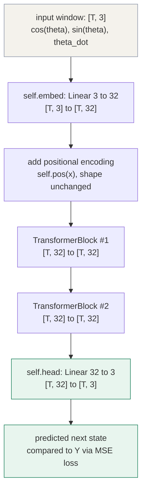
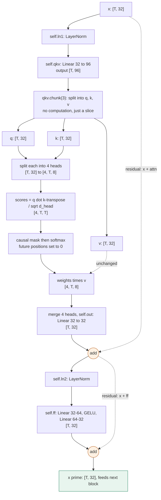

# Network: MLP & Transformer, from scratch, grounded in the pendulum

Every policy/value network used elsewhere in this repo (DQN, DDPG, SAC, TRPO,
PPO) is "some neural network" doing the heavy lifting. This folder opens that
black box: two self-contained scripts that build the two network families used
in modern RL — the MLP (single-state function approximator) and the
Transformer (sequence model) — with from-scratch math, a trained PyTorch
model, and visualizations, all on the same toy system (a pendulum) so the two
can be compared directly.

```
01_mlp.py           MLP: state -> output (energy-shaping swing-up torque)
02_transformer.py   Transformer: state HISTORY -> next state (self-attention)
03_mlp_cartpole.py       MLP policy, trained with RL, on cartpole swing-up
04_transformer_cartpole.py  Transformer policy, same task
05_compare_cartpole.py      MLP vs Transformer vs partial-observability ablations
figures/             outputs of 03/04/05 (gifs, plots) -- see figures/README.md
```

Run either file directly; both fall back gracefully if `torch`/`matplotlib`
are missing (the NumPy math sections still run):

```bash
python 01_mlp.py
python 02_transformer.py
```

---

## 1. MLP (`01_mlp.py`) — one state in, one output out

An inverted pendulum is observed as `s = [cos θ, sin θ, θ̇]` (3 numbers). An
MLP is the default way every actor/critic in this repo turns that vector into
a torque, a value estimate, or Q-values — it is just "vector in, vector out"
via a stack of `(linear map -> nonlinearity)`:

$$
h = \mathrm{act}(W_1 s + b_1), \qquad y = W_2 h + b_2
$$

Without the nonlinearity two linear layers collapse into one
($W_2(W_1 s) = (W_2 W_1) s$), so the activation is what lets the network bend
instead of only drawing straight lines — the universal approximation theorem
(Cybenko 1989, Hornik 1991) says that bend is enough to fit essentially any
smooth function with enough width. The script trains an MLP against a *known*
target, `target(s) = θ̇ · cos θ` (a classic energy-shaping swing-up signal), so
the approximation error can be watched directly instead of being hidden inside
a full RL loop.

**Key limitation this motivates part 2:** an MLP only ever sees *one* state.
It has no memory — give it the same `s` twice and it produces the same output,
regardless of what happened before. Real control problems are sequential
(momentum, partial observability, sensor delay): the right action now can
depend on recent history, not just the current frame.

---

## 2. Transformer (`02_transformer.py`) — a HISTORY in, informed by itself

Instead of one state, feed a trajectory window of `T` timesteps,
`S = [s_{t-T+1}, ..., s_t]`, and predict `s_{t+1}`. To do that well the network
must learn, *for each timestep*, which earlier timesteps are relevant — that
lookup is self-attention. This is also the mechanism behind Decision
Transformer (Chen et al., 2021): turning RL into sequence modeling by feeding
trajectories instead of single states.

### 2.1 The attention formula

$$
\mathrm{Attention}(Q, K, V) = \mathrm{softmax}\!\left(\frac{QK^\top}{\sqrt{d_k}}\right) V
$$

Every token (timestep) produces three vectors via learned linear projections
of its embedding:

- **Q (query)** — "what am I, this token, looking for?"
- **K (key)** — "what do I offer, for others to match against?"
- **V (value)** — "the actual content I carry, if selected."

Think of a lookup table: `Q` is the search you type, `K` is every entry's
title (compared against the search), `V` is the content you actually retrieve.

### 2.2 Step by step, with the shapes from the code

| step | code | shape | what happens |
|---|---|---|---|
| input | trajectory window | `[T, 3]` | `T` timesteps of `[cos θ, sin θ, θ̇]` |
| embed + position | `self.pos(self.embed(x))` | `[T, d_model]` | linear lift to `d_model=32`, add a fixed sin/cos signal so order survives (attention itself is order-agnostic) |
| QKV projection | `self.qkv(x)` then `.chunk(3)` | `[T, d_model]` each | **one learned matrix** produces Q, K, V together; split into `n_heads=4` heads of `d_head=8` |
| scores | `q @ k.transpose(-2,-1) / sqrt(d_head)` | `[heads, T, T]` | row `i`, col `j` = how much query `i` matches key `j` |
| causal mask | `scores.masked_fill(mask, -inf)` | `[T, T]` | upper triangle (the future) set to `-inf`: token `t` must never see `t+1, t+2, ...` |
| softmax | `scores.softmax(dim=-1)` | `[heads, T, T]` | each row turned into weights that sum to 1 — a *data-dependent, learned* weighted average, unlike an MLP's fixed weights |
| weighted sum | `weights @ v` | `[heads, T, d_head]` | token `i`'s new representation = weighted blend of every value `j <= i` it attends to |
| merge heads | `.transpose(1,2).view(...)` + `self.out(...)` | `[T, d_model]` | concatenate the 4 heads back together, mix with one more linear layer |
| residual + FF | `x = x + attn(...)`, `x = x + ff(...)` | `[T, d_model]` | add (not replace) the sublayer output; a small per-token MLP digests it further |
| stack | `n_blocks=2` | `[T, d_model]` | repeat attention+FF twice, each with its own residuals |
| output head | `self.head(x)` | `[T, 3]` | linear projection back to `[cos θ, sin θ, θ̇]`, the predicted next state |

The causal mask is what makes this a *decoder-style* (GPT-like) transformer:
token 0 can only attend to itself, token 1 to `{0, 1}`, etc. — the
lower-triangular structure visible in every printed attention matrix.

**The whole network, end to end** (matches `PendulumTransformer.forward()`):



**Inside one `TransformerBlock`** (identical for block #1 and #2 — shape
never changes, only content):



The two dashed arrows are the **residual connections**
(`x = x + attn(...)` and `x = x + ff(...)`) — without them, gradients would
have to flow through every sublayer of every stacked block to reach the
input; with them, there's always a direct path back, which is what lets
`n_blocks` stack deep and still train.

### 2.3 Why this beats flattening the window into an MLP

- Attention weights are **data-dependent**: a fast-spinning pendulum attends
  to different history than a slow one. An MLP's weights are fixed after
  training, regardless of the input.
- It relates *any two* timesteps directly — no information bottleneck from
  squeezing a whole window through one fixed-size hidden layer.
- Multi-head lets different heads specialize (e.g. one tracks angle, another
  velocity) without hand-designed features.

### 2.4 What the script produces

1. **Part 1 (`demo_attention_numpy`)** — scaled-dot-product attention written
   in raw NumPy with *random* (untrained) projections, just to print the
   mechanics: the score matrix, the causal mask, the resulting
   lower-triangular weight matrix.
2. **Part 2 (`PendulumTransformer`)** — a real, trained, 2-block causal
   transformer (PyTorch) predicting `s_{t+1}` at every timestep simultaneously,
   with a standard MSE loss against the true next state.
3. **Visualizations** — `plot_attention` compares the untrained NumPy weights
   against the *learned* attention map (what the trained model actually ended
   up attending to); `create_rollout_gif` feeds the model a short real history
   then lets it predict autoregressively (its own output fed back in as the
   next input) and animates true-vs-predicted pendulum motion side by side.

---

## 3. From toy math to RL (`03`–`05`)

`03_mlp_cartpole.py` and `04_transformer_cartpole.py` take the exact same two
architectures and drop them into an actual RL loop on cartpole swing-up;
`05_compare_cartpole.py` runs both (plus partial-observability ablations) side
by side to show *when* the Transformer's memory actually earns its extra
complexity over a plain MLP. See `figures/README.md` for the resulting plots
and gifs.
