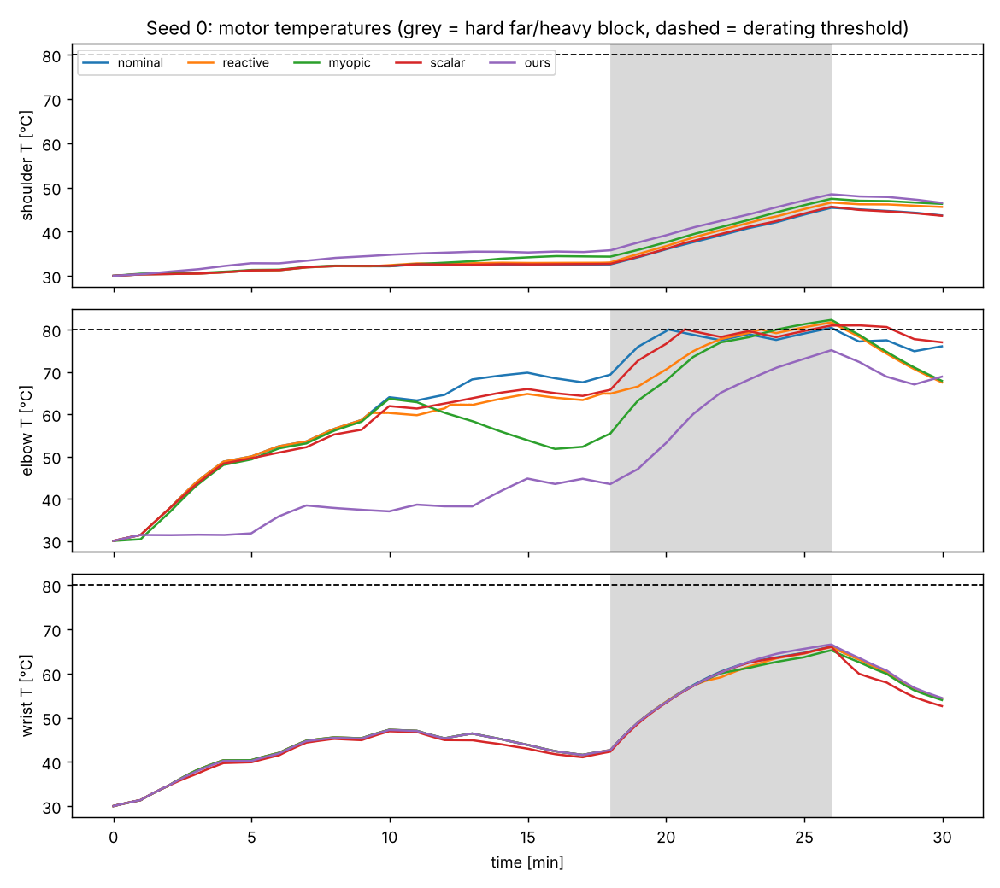

# Toy prototype: thermal preview control on a redundant 3-link arm

`thermal_preview_arm.py` is the minimal, numpy-only version of the idea in
`../IDEA_2_thermal_preview_humanoid.md`. Run it with:

```bash
python3 thermal_preview_arm.py --seeds 5     # about 1.5 min on CPU; writes outputs/results.json and a plot
```

**Setup.**
- A planar 3-link arm holds a payload at 30 one-minute targets (a known 30-minute "program"). Minutes 18–26 are a
  hard block: a far reach with a heavy payload.
- Each motor follows a lumped RC heat model. At 80 °C its torque limit drops to 50%. If no reachable pose fits
  within the limits, that second counts as a failure (payload dropped).
- **Fast layer:** given a per-joint allowance b, choose the pose (one redundant degree of freedom) that minimises
  tool-orientation error plus allowance-weighted squared torque.
- **Slow layer:** MPPI over the allowance schedule for the remaining program, re-planned every segment from the
  measured temperatures.

**Result (iteration 1, 5 seeds):**

| method | programs completed | derated | mean fail s | mean ori err (°) | hard-block ori err (°) |
|---|---|---|---|---|---|
| B0 nominal (b = 1) | 0/5 | 5/5 | 124.8 | 1.83 | 6.36 |
| B1 reactive (b from current T) | 2/5 | 4/5 | 30.4 | 2.36 | 6.83 |
| B3 myopic MPPI (1 segment) | 4/5 | 4/5 | 36.0 | 3.40 | 10.97 |
| B4 scalar-allowance preview | 0/5 | 5/5 | 107.2 | 6.15 | 6.63 |
| **ours (preview + per-joint)** | **5/5** | **0/5** | **0** | **0.73** | **0.50** |



The plot shows the core story. Ours moves elbow load onto the shoulder (which has thermal headroom) *before* the
hard block, so it enters the block cool. Planning ahead without redistribution (scalar) does not help, and
redistribution without planning ahead (reactive or myopic) is too late.

**Honest caveats (to fix in later iterations):**
- The planner uses the *exact* fast-layer response and the exact thermal model, so it is an oracle surrogate with
  no model mismatch.
- The arm is quasi-static. The fast layer is an argmin over poses, not a learned policy.
- The reactive baseline's threshold and span were not tuned.
- There are only 5 seeds and one program generator.
